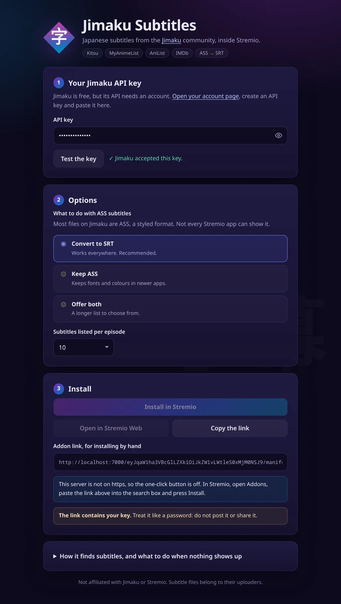

# Jimaku Subtitles for Stremio

A [Stremio](https://www.stremio.com) addon that adds **Japanese subtitles from the [Jimaku](https://jimaku.cc) community**
to anime and Japanese films and series. Most subtitles on Jimaku are in ASS, a styled format that many Stremio apps
cannot show, so the addon can **convert them to SRT** on the way.



* Works with the id schemes of the popular anime catalogues: **Kitsu, MyAnimeList, AniList, AniDB**, and with plain
  **IMDb** titles. Nothing to install besides this addon and one free Jimaku API key.
* **The subtitle made for your release comes first.** If the file you are playing is
  `[SubsPlease] Show - 05 (1080p).mkv`, the subtitle made for that release is at the top of the list: it is the one that stays in sync.
* **Exact matches.** Anime are found by their AniList id, films and series by their TMDB id; a title search is only the last resort.
* **Friendly to Jimaku.** Few requests, answers shared between everybody on the server, and its rate limit is obeyed.
* **No dependencies at runtime**, one small server, no database. Your key is never stored or logged.

## Install

You need a **Jimaku API key**: create a free account on [jimaku.cc](https://jimaku.cc), open
[your account page](https://jimaku.cc/account) and generate a key.

The addon is a small web server that you run yourself (below). Then:

1. Open its setup page (`/configure`, for example `http://localhost:7000/configure`).
2. Paste your key and press **Test the key**. Choose what to do with ASS subtitles.
3. Press **Install in Stremio**, or copy the link and paste it into the search box of Stremio's *Addons* page.

The link contains your key, so treat it like a password. Anyone who has it can make requests as you.

Stremio installs an addon over **https**, except from `localhost`. To use it away from home, run it behind a host
that gives you https (Beamup, a reverse proxy, a tunnel), and see [Configuration](#configuration).

### Run it with Node

Node.js 20 or newer. There is nothing to install.

```bash
git clone <this repository>
cd jimaku-subs-stremiov2
npm start                       # http://localhost:7000/configure
```

### Run it with Docker

```bash
docker build -t jimaku-subs .
docker run -d --name jimaku-subs --restart unless-stopped -p 7000:7000 \
  -e BASE_URL=https://subs.example.com jimaku-subs
```

The image is Node plus the source (about 170 MB, nearly all of it the Node base image), runs as an unprivileged user and has a health check on `/health`.

### Deploy to Beamup (free hosting for Stremio addons)

```bash
npm install -g beamup-cli
beamup                          # host: a.baby-beamup.club, then your GitHub username
```

`app.json` and `beamup.json` in this repository hold the health checks Beamup uses. Beamup tells the app which `PORT`
to use, and the addon works out its own public address from the request headers; set `BASE_URL` only if the links on
the setup page come out wrong.

### One key for everybody (a private server)

If the server is only for you and your household, give it the key once and skip the setup page for users:

```bash
JIMAKU_API_KEY=your-key npm start
```

The plain `http://…/manifest.json` then installs directly, and every request uses that key. Do not do this on a public server: it would spend your key's requests for everyone.

## Configuration

Everything is optional. Set these environment variables:

| Variable | Default | What it does |
| --- | --- | --- |
| `PORT` | `7000` | Port to listen on (`HOST`, default `0.0.0.0`, is the address) |
| `BASE_URL` | worked out from each request | Public address of the server, e.g. `https://subs.example.com`. Behind a proxy that does not send `X-Forwarded-Host`/`-Proto` |
| `JIMAKU_API_KEY` | none | A key used when the request carries none (see above) |
| `LOG_LEVEL` | `info` | `debug`, `info`, `warn`, `error` or `silent` |
| `LOG_FORMAT` | `pretty`, or `json` when `NODE_ENV=production` | One JSON object per line is easier for log tools |
| `USER_AGENT` | `jimaku-subs-stremio/<version> (Stremio addon)` | Sent to Jimaku, Kitsu, AniList and Cinemeta; Jimaku asks for a descriptive one. Add a contact if you run a public server |
| `PUBLISH_TO_CENTRAL` | `false` | `true` announces `BASE_URL/manifest.json` to Stremio's community catalogue at start-up |
| `UPSTREAM_TIMEOUT_MS` | `6000` | How long to wait for each outside service |
| `REQUEST_TIMEOUT_MS` | `15000` | After this, a subtitle request is answered with an empty list instead of keeping Stremio waiting |
| `MAX_SUBTITLE_BYTES` | `4194304` | Largest subtitle file the converter will accept |
| `JIMAKU_MIN_INTERVAL_MS` | `250` | Minimum gap between this server's calls to Jimaku |
| `VALIDATE_PER_MINUTE` | `20` | How often one visitor may press *Test the key* |

For tests and demos the services' addresses can be replaced (`JIMAKU_API_URL`, `KITSU_API_URL`, `ANILIST_API_URL`,
`CINEMETA_URL`, `JIMAKU_DOWNLOAD_HOSTS`); see `src/config.js`.

### Listing it in the Stremio community catalogue

Announcing the addon is a deliberate step, not something every start-up does. Either set `PUBLISH_TO_CENTRAL=true` together with
`BASE_URL`, or run once, with the address of the *unconfigured* manifest (everyone installs from that one):

```bash
npm run publish-to-stremio -- https://subs.example.com/manifest.json
```

## How it finds the right subtitle

1. **Which title is it?**
   `kitsu:ID` is mapped to an AniList id with Kitsu's own mapping data; `mal:ID` through AniList; `anidb:ID` through Kitsu;
   `anilist:ID` is already one. An IMDb id (`tt…`) is looked up in Cinemeta (Stremio's own metadata service, no key
   needed) to get its TMDB id. With an AniList or TMDB id the Jimaku entry is exact.
2. **Seasons.** Jimaku keeps a separate entry for each season of many shows. Asked for season 2 of such a show, the addon takes the
   entry that says "2nd Season" and nothing else; if Jimaku has no entry for that season the answer is *no subtitles*, never the wrong season's.
3. **Only if there is no id** (a Kitsu entry with no AniList mapping): a title search, at most two requests, accepting only close matches.
4. **Which files?** The files of the episode, minus anything Stremio cannot read (ZIP and other archives).
5. **In what order?** The subtitle whose release matches the video's file name (release group, resolution, source) first;
   then plain SRT and VTT, converted ASS, and original ASS. Each has a label such as `SubsPlease · 1080p · ASS→SRT`.

### ASS subtitles

| Setting | What Stremio is offered |
| --- | --- |
| **Convert to SRT** (default) | A converted copy, which works in every app. Styling and positions are dropped; italics are kept; vector drawings and scrolling credits are removed; lines repeated for outlines, shadows or karaoke show once |
| **Keep ASS** | The original file. Newer apps show its fonts and colours; others show nothing |
| **Offer both** | Both entries, for choosing in the player |

Converted files are decoded from UTF-8, UTF-16, Shift-JIS and EUC-JP, written as UTF-8 SRT, and kept in memory for six hours.
The converter only ever fetches Jimaku download addresses on the configured hosts, follows redirects only to those hosts, and refuses files over the size limit.

### Rate limits and caching

Jimaku limits how many requests one address can make in a short window, and all users of a server share that budget. So:
calls go through one queue, answers are cached for everyone (hours when something was found, minutes when not),
identical lookups at the same moment share one request, and a `429` is obeyed: a short wait is waited out, a long one is answered with
an empty list that Stremio retries in a minute. Stremio is told how long it may remember each answer (`Cache-Control`).

## Coming from version 1

* **Your installed links keep working.** The address format, the settings inside it and the addon's id are unchanged, so Stremio treats this
  as an update. The old `omdbApiKey` setting is ignored: IMDb titles now go through Cinemeta, which needs no key.
* **New**: seasons, MAL/AniList/AniDB ids, anime catalogue type, release-aware ordering, labels, an option for ASS, a key test,
  `JIMAKU_API_KEY` mode, Docker, health check.
* **Fixed**: subtitles requested by two people at once could be mixed up (the old server kept the current title in a global variable);
  the server's public address was the author's Beamup address, in production, whatever host it ran on; API keys were written to the logs
  inside URLs; empty and error answers were cached for 20 minutes; the setup page loaded fonts and icons from CDNs; every start in production published the addon
  to Stremio's catalogue.
* **Changed**: converted subtitles are stateless (`/convert/<token>.srt`) instead of living in server memory; the server no longer
  depends on `express`, `stremio-addon-sdk` or `bent`; the default port is 7000 (the old README said 7005 and the code used 7006).

## Development

```bash
npm test               # 200+ tests, about a second, no network
npm run lint
npm run dev:mock       # the whole addon against a pretend Jimaku: http://localhost:7000/configure
npm run dev            # against the real services, restarting on changes
```

`npm run dev:mock` needs no Jimaku account: any key of 8+ characters works, except one that starts with `bad` (to see the rejected-key message).
It knows Frieren (`kitsu:46474`, `tt22248376`), *Your Name.* (`tt5311514`) and Attack on Titan (`tt2560140`); the output tells you what to try.

```
src/
  app.js            the HTTP routes and headers          config.js, logger.js, http.js, cache.js
  server.js         start, stop, publish
  jimaku/           the Jimaku API client; matching titles, seasons, releases
  meta/             Kitsu, AniList, Cinemeta
  stremio/          manifest, ids, the user's settings, the subtitle lookup
  subs/             ASS parser and SRT writer, text encodings, the safe converter
public/             the setup page (no inline script or style, nothing loaded from other sites)
scripts/            the pretend upstream for tests and demos, and the publish script
```

The setup page is served with a strict Content-Security-Policy (`default-src 'none'`, scripts and styles from the same origin only).

### Limits

* Subtitles that Jimaku only offers inside archives (ZIP, RAR) cannot be shown; Stremio does not open archives.
* SRT and VTT files are handed to Stremio as they are, so a file saved in an old Japanese encoding depends on the app to decode it. ASS files are always converted to UTF-8.
* Which episode a file belongs to is Jimaku's own best guess; the addon trusts it, and drops files that name another season.

## Credits

A fork of [jimaku-subs-stremio](https://github.com/Pedrubik2000/jimaku-subs-stremio) by Pedrubik2000, under its MIT licence (see `LICENSE`).
Subtitles are provided by the [Jimaku](https://jimaku.cc) community and belong to their uploaders; anime metadata comes from
[Kitsu](https://kitsu.io), [AniList](https://anilist.co) and [Cinemeta](https://v3-cinemeta.strem.io). Not affiliated with Jimaku or Stremio.
